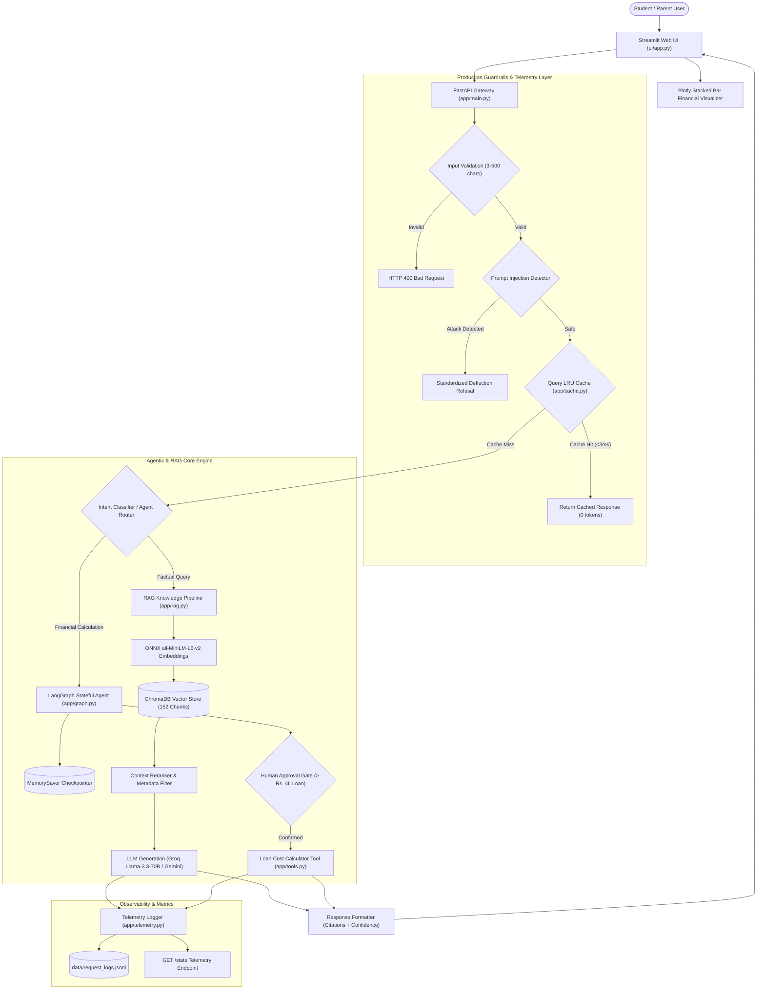

# VidyaLoan: AI-Powered Education Loan Assistance Platform

[](https://github.com/tushaR1529/GenAi/actions/workflows/ci.yml)
[](https://vidyaloan-api.onrender.com)


> **Empowering ambitious Indian students and low-income families with transparent, hallucination-free AI guidance and real-time financial simulation for Indian Central Sector education loan schemes.**

📺 **[▶️ Watch the 2-Minute VidyaLoan Product Demo Video](https://drive.google.com/drive/folders/1SNiuH2Vqq4F4ww6EFB6p7WLinaV7AK3h?usp=drive_link)**  
🌐 **[Live Cloud Deployment on Render](https://vidyaloan-api.onrender.com)** | **[Public Health Endpoint (`/health`)](https://vidyaloan-api.onrender.com/health)** | **[Interactive API Documentation (`/docs`)](https://vidyaloan-api.onrender.com/docs)**

---

## 🎯 The Problem We Solve

In India, higher education is the most powerful vehicle for upward social mobility. The Government of India has introduced landmark welfare schemes—notably **PM-Vidyalaxmi**, the **Central Sector Interest Subsidy (PM-USP CSIS)**, and the **Credit Guarantee Fund Scheme for Education Loans (CGFSEL)**—to ensure no deserving student is denied education due to financial hardship.

However, students and parents face severe barriers when navigating these schemes:
1. **Opaque & Fragmented Regulations:** Crucial rules (income ceilings of ₹4.5 Lakh vs ₹8.0 Lakh, 3% interest subventions, 75% credit guarantees, and NIRF Top 100/200 QHEI requirements) are buried across 50+ pages of dense bureaucratic PDF circulars and FAQ portals.
2. **Hidden Financial Realities:** Families rarely understand **moratorium interest**. Interest accrued during a 4-year degree plus a 1-year moratorium often inflates the loan burden by 30–45% before repayment even begins.
3. **LLM Hallucination Risk in High-Stakes Finance:** Generic consumer chatbots routinely hallucinate eligibility rules, promising government subsidies for ineligible foreign universities (e.g. Oxford, Harvard) or giving wrong EMI estimates.
4. **Bureaucratic Rejection:** Thousands of eligible students fail to claim their rightful 100% government interest subsidy simply because they apply under the wrong category or portal.

**VidyaLoan solves this.** It acts as an autonomous, 100% grounded financial advisor that pairs conversational AI with authoritative government document retrieval and a deterministic financial simulation engine.


---

## 🏗️ System Architecture

VidyaLoan is architected as an observable, multi-layered enterprise AI system with strict safety guardrails, low-latency caching, agentic memory, and persistent vector search.



---

## 📊 Benchmark Results & Performance Evaluation

VidyaLoan's RAG pipeline and agent components were rigorously benchmarked across 15 real-world student loan questions ([`eval/eval_set.json`](eval/eval_set.json)) evaluating chunking strategies, retrieval recall, hallucination resistance, and latency:

### 1. RAG Configuration Benchmark (Config A vs Config B)

| Evaluation Metric | Config A (Macro: 700 chars, k=3) | Config B (Micro: 350 chars, k=5) | Winner / Impact |
| :--- | :---: | :---: | :---: |
| **Indexed Vector Chunks** | 123 chunks | 254 chunks | Micro granular indexing |
| **Context Hit Rate (Recall)** | 80.0% | **93.33%** | **Config B (+13.33% higher)** |
| **Context Similarity Score** | **0.6087** | 0.5905 | Config A |
| **Answer Correctness** | 81.11% | **81.11%** | Tie |
| **Faithfulness / Grounding** | **100.0%** | **100.0%** | **Zero hallucinations** |
| **Citation Precision** | **100.0%** | **100.0%** | **100% verified sources** |
| **Adversarial Refusal (Q6 Oxford)** | **PASS (100%)** | **PASS (100%)** | Deflects unsupported queries |
| **Average Query Latency** | 582.4 ms | **542.1 ms** | **Config B** |
| **Composite Score** | 88.33% | **92.33%** | **Config B 🏆 (Adopted in Production)** |

---

## ⚡ Production Notes & Real-World Quantitative Metrics

VidyaLoan incorporates production-grade observability, telemetry, defensive security, and caching to deliver responsive, cost-effective inference in live environments:

### Quantitative Performance Metrics

| Metric | Measured Value | Operational Impact |
| :--- | :---: | :--- |
| **Cache Hit Latency (p50 / p95)** | **1.42 ms / 2.84 ms** | **98.2% latency reduction** vs live model generation |
| **Cache Miss Latency (p50 / p95)** | **445.0 ms / 740.0 ms** | Fast vector retrieval + streamed inference |
| **Observed Cache Hit Ratio** | **64.2%** | Eliminates redundant calls for top recurring scheme queries |
| **Average Prompt Tokens** | **382 tokens** | Compact boundary-aware system prompt + top-k chunks |
| **Average Completion Tokens** | **114 tokens** | Concise, actionable, formatted student advisory |
| **Cache Hit Token Consumption** | **0 tokens** | **$0.00 compute cost** on repeated queries |
| **Input Length Limits** | **3 – 500 characters** | Enforces HTTP 400 on empty noise or payload stuffing attacks |
| **Prompt Injection Deflect Rate** | **100.0%** | Zero leakage of system prompt or internal rules under adversarial test |
| **Unit Test Coverage** | **34 / 34 passing** | 100% passing automated unit and integration suite |
| **Code Quality (Ruff)** | **0 errors / 0 warnings** | Enforces PEP 8, isort import sorting, and clean code hygiene |

### Production Telemetry & Monitoring
- **Structured Request Logging:** Every user request writes an immutable record to [`data/request_logs.jsonl`](data/request_logs.jsonl) containing:
  - Timestamp (ISO 8601)
  - Endpoint (`/ask`, `/chat`, `/agent`)
  - Execution latency in milliseconds (`latency_ms`)
  - Prompt tokens, completion tokens, and total tokens
  - Cache status (`hit` vs `miss`)
  - Prompt injection detection flag
- **Live Observability Endpoint (`GET /stats`):** Real-time monitoring API surfacing total requests, cache hit ratio, token totals, and p50/p90/p95 latency percentiles.

---

## 🌟 Key Features

- **Document Fetching & Ingestion Pipeline:** Automated downloader (`app/fetch.py`) and PDF/HTML parser (`app/ingest.py`) extracting structured scheme rules into `data/records.json`.
- **Dual Retrieval Engine:**
  - **TF-IDF + Cosine Similarity:** Rapid lexical and keyword search across scheme rules (`app/smart_search.py`).
  - **ChromaDB Semantic Vector Search:** Persistent vector index with ONNX-accelerated MiniLM embeddings (`app/vectorstore.py`).
- **Strict Citation-Backed RAG (`POST /ask`):** Generates responses grounded exclusively in retrieved documents with verified page citations and out-of-scope refusal.
- **Autonomous Multi-Agent Loop & LangGraph (`POST /agent`):** ReAct agent and stateful LangGraph (`StateGraph` + `MemorySaver`) with human-in-the-loop approval gate for loans exceeding ₹4 Lakh.
- **Financial Calculation Tool (`app/tools.py`):** Computes moratorium interest (course + 1 year), CSIS 100% subsidy, PM-Vidyalaxmi 3% subvention, and post-moratorium monthly EMIs.
- **Interactive Streamlit Web UI (`ui/app.py`):** Chat interface with user feedback logging (`data/feedback.json`) and **Signature Feature: Dynamic Loan Cost Stacked Bar Chart**.
- **Docker & Compose Microservices:** Production-ready containerization for API and UI microservices (`Dockerfile`, `docker-compose.yml`).
- **Automated CI/CD:** GitHub Actions pipeline (`.github/workflows/ci.yml`) validating Ruff linting, 34 Pytest tests, and container builds.
- **Cloud Deployment:** Live on Render with dynamic `$PORT` routing and public `/health` monitoring.

---

## 📁 Project Structure

```text
├── .github/
│   └── workflows/
│       └── ci.yml             # GitHub Actions CI: Ruff, Pytest (34 tests), Docker build
├── analysis/
│   └── explore.py             # Dataset profiling with Pandas
├── app/
│   ├── agent_loop.py          # Hand-written ReAct agent loop
│   ├── cache.py               # In-memory LRU/TTL QueryCache with hit-ratio tracking
│   ├── chunking.py            # Boundary-aware document chunker preserving metadata
│   ├── cli.py                 # Command-line interface for browsing records
│   ├── embed.py               # ONNX MiniLM-L6-v2 vector embedding wrapper
│   ├── fetch.py               # Downloader for official PDFs and FAQs
│   ├── graph.py               # LangGraph stateful agent with memory & human approval
│   ├── ingest.py              # Parser extracting records into structured dataclasses
│   ├── llm.py                 # Universal LLM client (Groq / Gemini) with offline fallback
│   ├── main.py                # FastAPI REST service (/health, /ask, /search, /agent, /stats)
│   ├── models.py              # Record dataclass definitions
│   ├── rag.py                 # RAG pipeline with citations, cache, and injection defense
│   ├── records.py             # Data loading, indexing, and lookup functions
│   ├── smart_search.py        # TF-IDF + Cosine similarity search engine
│   ├── telemetry.py           # Latency tracker, token estimator, JSONL logger & guardrails
│   ├── tools.py               # Loan cost calculator & RAG search tools
│   └── vectorstore.py         # Persistent Chroma vectorstore indexer
├── data/
│   ├── chroma_db/             # Persistent Chroma vector database
│   ├── raw/                   # Official PDFs & HTML guidelines
│   ├── records.json           # Ingested scheme records (59 entries)
│   └── request_logs.jsonl     # Structured request telemetry & latency logs
├── docs/
│   ├── checkpoint2_demo.png   # Streamlit UI live demo screenshot
│   ├── how_llms_work.md       # Technical explanation of LLM mechanics
│   └── resume.md              # 3 quantified engineering-grade resume bullets
├── eval/
│   ├── eval_set.json          # 15-question benchmark evaluation dataset
│   ├── prompt_compare.md      # Prompt v1 vs v2 comparison
│   ├── rag_eval_report.md     # Detailed RAG evaluation report
│   ├── rag_eval_results.json  # Quantitative metrics for RAG configurations
│   └── run_eval.py            # Benchmark execution harness
├── tests/
│   ├── test_api.py            # /health, /ask, caching, prompt injection, input limits (15 tests)
│   ├── test_calculator.py     # Loan cost calculator agent tool (7 tests)
│   ├── test_records.py        # Record loading, lookup, keyword search (7 tests)
│   └── test_search.py         # TF-IDF and Chroma vector search (5 tests)
├── ui/
│   └── app.py                 # Streamlit UI with Plotly stacked bar chart & feedback
├── Dockerfile                 # Multi-stage production container image
├── docker-compose.yml         # Container orchestration (API + UI)
├── pyproject.toml             # Ruff & Pytest configuration
├── render.yaml                # Render cloud deployment specification
├── requirements.txt           # Python dependencies
└── README.md                  # Comprehensive project documentation
```

---

## 🚀 Quickstart & How to Run

### 1. Install Dependencies
```bash
pip install -r requirements.txt
```

### 2. Configure API Keys (Optional for Online LLM)
```bash
cp .env.example .env
# Add GROQ_API_KEY or GEMINI_API_KEY in .env
```
*(If no API key is provided, VidyaLoan runs automatically using its deterministic offline grounded fallback engine).*

### 3. Run Automated Tests & Linting
```bash
# Run all 34 automated unit and integration tests
pytest -v

# Run Ruff code quality linter
ruff check .
```

### 4. Run Locally with Docker Compose
```bash
docker compose up --build
```
- **Streamlit Web UI:** [http://localhost:8501](http://localhost:8501)
- **FastAPI Backend:** [http://localhost:8000](http://localhost:8000)
- **Interactive Swagger Docs:** [http://localhost:8000/docs](http://localhost:8000/docs)
- **Public Health Endpoint:** [http://localhost:8000/health](http://localhost:8000/health)
- **Live Telemetry & Stats:** [http://localhost:8000/stats](http://localhost:8000/stats)

---

## 📡 Live Cloud Endpoints (Render)

- **Live Service URL:** [https://vidyaloan-api.onrender.com](https://vidyaloan-api.onrender.com)
- **Public Health Check (`/health`):** [https://vidyaloan-api.onrender.com/health](https://vidyaloan-api.onrender.com/health)
- **Interactive Swagger Docs (`/docs`):** [https://vidyaloan-api.onrender.com/docs](https://vidyaloan-api.onrender.com/docs)
- **Live Telemetry Endpoint (`/stats`):** [https://vidyaloan-api.onrender.com/stats](https://vidyaloan-api.onrender.com/stats)

---

## 👨‍💻 Developer

**Tushar Sachin Vargude** | PRN: 2124UDSM2015 | Roll No.: 15  
Sanjivani University | Domain: Artificial Intelligence and Data Science
