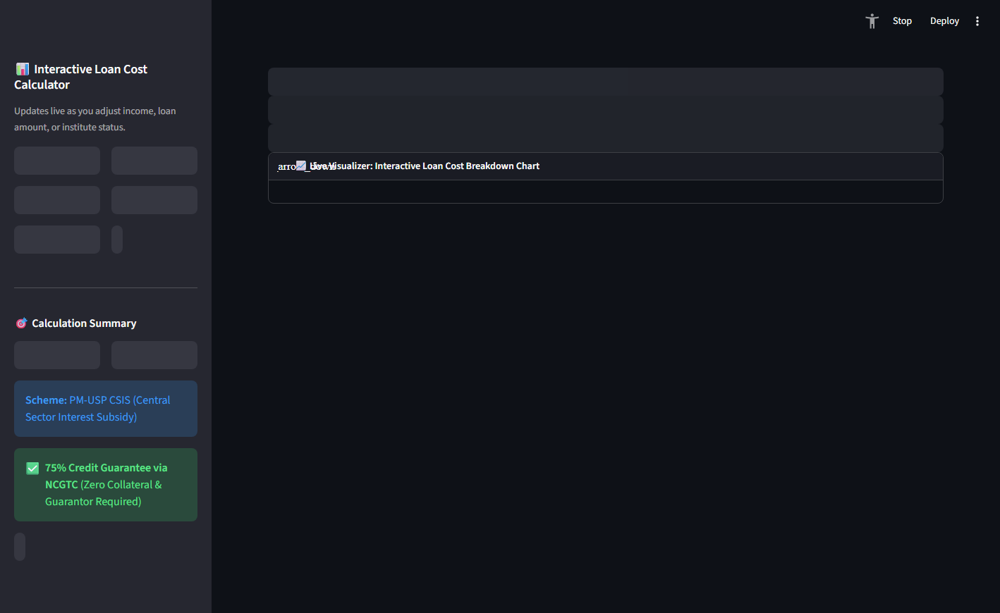

# VidyaLoan: AI-Powered Education Loan Assistance System

[](https://github.com/tushaR1529/GenAi/actions/workflows/ci.yml)

**Product:** VidyaLoan is an AI assistant that explains Indian government education loan schemes (PM-Vidyalaxmi, PM-USP CSIS, and CGFSEL) in simple, accessible language.

**Target User:** Students and parents, especially from families with an annual income under Rs. 8 lakh, who need guidance understanding which education loan scheme applies to them.

**Problem:** Multiple overlapping schemes have different income limits, subsidies, and guarantee rules. Families often struggle to identify what they qualify for, how much the government will cover, and what the loan will actually cost over time.

**Data Sources:**
- **PM-Vidyalaxmi Scheme Guidelines:** Press Information Bureau / Ministry of Education ([PIB Guidelines PDF](https://static.pib.gov.in/WriteReadData/specificdocs/documents/2026/jul/doc2026729936401.pdf))
- **PM-Vidyalaxmi Official Portal FAQs:** [pmvidyalaxmi.co.in FAQs](https://pmvidyalaxmi.co.in/PublicFaq.aspx)
- **Central Sector Interest Subsidy (PM-USP CSIS) Guidelines:** Canara Bank / Ministry of Education ([CSIS Guidelines PDF](https://www.canarabank.bank.in/documents/d/guest/csis-guideline-01-04-2022))

---

## Features

- **Document Fetching & Ingestion Pipeline:** Automated downloader (`app/fetch.py`) and PDF/HTML parser (`app/ingest.py`) extracting structured scheme rules into `data/records.json`.
- **Smart Search (TF-IDF + Cosine Similarity):** Relevance-ranked keyword and semantic similarity search across loan criteria, benefits, and scheme rules (`app/smart_search.py`).
- **RESTful FastAPI Service:** Endpoints for health checks, record retrieval, TF-IDF smart search, semantic vector search, user questions, and AI chat (`app/main.py`).
- **Document Chunking & Embeddings (Day 7):** Boundary-aware chunking preserving source, page, and title metadata (`app/chunking.py`) with ONNX-accelerated MiniLM embedding wrapper (`app/embed.py`).
- **Persistent Chroma Vectorstore (Day 7):** Persistent Chroma collection indexing document chunks with metadata filtering and similarity search (`app/vectorstore.py`).
- **Semantic Search Endpoint (`GET /search/semantic`):** High-speed semantic search retrieving grounded context with similarity scores (`app/main.py`).
- **RAG Answering with Citations (Day 8):** RAG answering pipeline (`app/rag.py` & `POST /ask`) answering questions strictly from retrieved chunks with structured source citations (`source`, `page`, `title`).
- **Out-of-Scope Guardrails (Day 8):** Enforced guardrails that refuse unsupported queries (such as foreign studies at Oxford University in Q6) with `"I don't know"`.
- **RAG Configuration Benchmark (Day 8):** 15-question evaluation suite (`eval/eval_set.json` & `eval/run_eval.py`) benchmarking chunk size and top-k retrieval configurations.
- **Education Loan Cost Calculator Tool (Day 9):** Accurate financial calculation tool (`app/tools.py`) computing moratorium interest (course + 1 year), government subsidy/subvention share (100% via CSIS if income <= Rs. 4.5L, 3% points via PM-Vidyalaxmi if income <= Rs. 8L at QHEIs), post-moratorium monthly EMI, and 75% credit guarantee eligibility.
- **Autonomous Agent Loop (Day 9):** Hand-written ReAct agent (`app/agent_loop.py`) that autonomously routes student inquiries between RAG knowledge retrieval and the financial calculation tool.
- **LangGraph Stateful Agent with Memory & Human Approval (Day 9):** LangGraph workflow (`app/graph.py`) powered by `StateGraph` and `MemorySaver` checkpointer with an interactive approval gate requiring confirmation for high-value financial calculations.
- **Agent REST Service (`POST /agent`):** Full multi-turn conversational agent endpoint with approval resumption support (`app/main.py`).
- **Interactive Streamlit Web UI (Day 10 - Checkpoint 2):** Full-featured web application (`ui/app.py`) featuring conversational RAG chat, verified citations, user thumbs up/down feedback logging, and an interactive **Loan Cost Breakdown Stacked Bar Chart** visualizing government subsidies vs family financial commitments.
- **Automated Pytest Suite & Ruff Code Quality (Day 11):** 30-test hermetic test suite (`tests/`) verifying record loaders, TF-IDF and Chroma vector search, `/health`, `/ask` with a fake LLM, and `education_loan_cost_calculator`; `ruff check .` passes with 0 errors.
- **Docker & Docker Compose Containerization (Day 11):** Production-ready `Dockerfile`, `.dockerignore`, and `docker-compose.yml` orchestrating the FastAPI backend and Streamlit UI in isolated networked containers with single-command startup.
- **Continuous Integration Pipeline (Day 12):** GitHub Actions workflow (`.github/workflows/ci.yml`) automating code quality checks with `ruff`, running all 30 `pytest` tests, and validating Docker builds on every push and pull request with live status badge.
- **Cloud Deployment & Public Health Monitoring (Day 12):** Production cloud deployment configurations for Render (`render.yaml`) and Hugging Face Spaces supporting dynamic `$PORT` assignment and public `/health` monitoring.
- **LLM Provider Wrapper (Groq / Gemini):** Universal LLM client with system prompt grounding, JSON output parsing, and resilient fallback (`app/llm.py`).
- **Prompt Engineering & Systematic Evaluation:** Dual prompt versions (Direct Factual vs Comprehensive Advisory) evaluated across 10 real user questions (`eval/prompt_compare.md`).
- **Exploratory Data Analysis:** Fast pandas-based dataset profiling computing distribution across schemes, categories, and income limits (`analysis/explore.py`).
- **Interactive CLI & Exploration:** Command-line interface for searching and inspecting scheme records (`app/cli.py`).

---

## Technologies

- **Backend & API:** Python 3.11+, FastAPI, Uvicorn, Pydantic, Python-dotenv
- **Agent Workflows & Memory:** LangGraph (`StateGraph`), LangChain-Core, `MemorySaver` checkpointer
- **LLMs & Prompt Engineering:** Groq (Llama-3.3-70B), Google Gemini (Gemini 1.5 Flash), Requests
- **Data & Text Processing:** Pandas, Scikit-learn (TF-IDF), PyPDF, BeautifulSoup4
- **Data Models:** Python dataclasses (`app/models.py`)

---

## Project Structure

```text
├── analysis/
│   └── explore.py             # Prints 3 key facts about records using Pandas
├── app/
│   ├── agent_loop.py          # Day 9: Hand-written ReAct agent loop
│   ├── chunking.py            # Day 7: Document chunker preserving source, page, title
│   ├── cli.py                 # Command-line interface for browsing records
│   ├── embed.py               # Day 7: Embedding wrapper using all-MiniLM-L6-v2 ONNX
│   ├── explore.py             # Mirror for exploratory analysis
│   ├── fetch.py               # Fetches official government PDFs & HTML FAQs
│   ├── graph.py               # Day 9: LangGraph stateful agent with memory & human approval
│   ├── ingest.py              # Parses raw documents into structured Record dataclasses
│   ├── llm.py                 # Day 6: Groq/Gemini provider wrapper + JSON parser
│   ├── main.py                # FastAPI REST service (/health, /records, /search, /chat, /ask, /agent)
│   ├── models.py              # Record dataclass definition
│   ├── rag.py                 # Day 8: RAG pipeline with citations & out-of-scope refusal
│   ├── records.py             # Data loading, search, and lookup functions
│   ├── smart_search.py        # TF-IDF vectorizer + Cosine similarity search engine
│   ├── tools.py               # Day 9: Loan cost calculator & RAG search tools
│   └── vectorstore.py         # Day 7: Persistent Chroma collection indexer & searcher
├── data/
│   ├── chroma_db/             # Day 7: Persistent Chroma database
│   ├── raw/                   # Downloaded government guidelines and FAQs
│   │   ├── csis_guidelines.pdf
│   │   ├── pm_vidyalaxmi_faq.html
│   │   └── pm_vidyalaxmi_guidelines.pdf
│   ├── questions.json         # 10 real VidyaLoan user questions
│   ├── records.json           # Ingested scheme records (59 structured entries)
│   └── sample_records.py      # Baseline seed records
├── docs/
│   ├── checkpoint2_demo.png   # Day 10: Streamlit UI live demo screenshot (Checkpoint 2)
│   └── how_llms_work.md       # Day 5: How LLMs work, diagram, 10 user questions, Checkpoint 1
├── eval/
│   ├── eval_set.json          # Day 8: 15-question benchmark evaluation dataset
│   ├── generate_search_eval.py# Day 7: Semantic search evaluation script
│   ├── prompt_compare.md      # Day 6: Comparison of Prompt v1 vs Prompt v2 across 10 questions
│   ├── rag_eval_report.md     # Day 8: Detailed RAG evaluation report and winner analysis
│   ├── rag_eval_results.json  # Day 8: Quantitative metrics for tested RAG configs
│   ├── results.json           # Day 6: Benchmark evaluation outputs
│   ├── run_eval.py            # Day 8: RAG configuration benchmark execution harness
│   ├── search_results.md      # Day 7: Semantic search hits report across 10 benchmark questions
│   └── test_agent_day9.py     # Day 9: Comprehensive automated test suite for agent tools & LangGraph
├── prompts/
│   ├── system_prompt.txt      # Core VidyaLoan system prompt & constraints
│   ├── task_prompt_v1.txt     # Task prompt version 1: Direct & rule-centric
│   └── task_prompt_v2.txt     # Task prompt version 2: Comprehensive student advisory
├── tests/                     # Day 11: 26 automated unit and integration tests
│   ├── __init__.py
│   ├── test_api.py            # /health, /records, /search/semantic, /ask with fake LLM, /agent
│   ├── test_calculator.py     # Loan cost calculator agent tool (CSIS, PM-Vidyalaxmi, CGFSEL)
│   ├── test_records.py        # Record loading, lookup, and keyword search
│   └── test_search.py         # TF-IDF SmartSearch and Chroma semantic search
├── ui/
│   └── app.py                 # Day 10: Streamlit Chat UI, Stacked Bar Chart & Feedback
├── .dockerignore              # Day 11: Exclusions for Docker builds
├── .env.example               # Template for LLM API keys (.env is not committed)
├── day01_intro.py             # Day 1 project card demonstration
├── Dockerfile                 # Day 11: Multi-service container image
├── docker-compose.yml         # Day 11: Multi-container orchestration (API + UI)
├── pyproject.toml             # Day 11: Ruff linter & Pytest test suite configuration
├── requirements.txt           # Project dependencies
└── README.md                  # Project documentation & instructions
```

---

## How to Run

### 1. Install Dependencies
```bash
pip install -r requirements.txt
```

### 2. Configure Environment (Optional for Live LLMs)
Copy `.env.example` to `.env` and insert your Gemini or Groq API key:
```bash
cp .env.example .env
```
*(If no API key is provided, `app/llm.py` automatically uses its deterministic grounded fallback engine for offline testing and evaluation).*

### 3. Fetch Government Documents (Day 3)
Downloads official PM-Vidyalaxmi guidelines, PM-USP CSIS guidelines, and portal FAQs with timeouts and SSL handling:
```bash
python -m app.fetch
```

### 4. Ingest Documents into Structured Records (Day 3)
Extracts and normalizes scheme records into `data/records.json`:
```bash
python -m app.ingest
```

### 5. Run Exploratory Analysis (Day 4)
Prints 3 key dataset facts using Pandas:
```bash
python analysis/explore.py
```

### 6. Launch FastAPI Service (Day 4, 5 & 6)
Start the REST API server:
```bash
uvicorn app.main:app --reload --port 8000
```
Open interactive Swagger documentation in your browser at:
**[http://127.0.0.1:8000/docs](http://127.0.0.1:8000/docs)**

#### Available API Endpoints:
- `GET /health`: Returns service status and total ingested record count.
  ```bash
  curl http://127.0.0.1:8000/health
  ```
- `GET /records?limit=10`: Returns a list of scheme records up to the specified limit.
  ```bash
  curl http://127.0.0.1:8000/records?limit=5
  ```
- `GET /records/{id}`: Returns a single record by ID (or 404 if missing).
  ```bash
  curl http://127.0.0.1:8000/records/1
  ```
- `GET /search?q={query}`: Searches records using TF-IDF and Cosine similarity.
  ```bash
  curl "http://127.0.0.1:8000/search?q=interest+subvention"
  ```
- `GET /search/semantic?q={query}&limit=5` (Day 7): High-speed semantic search over indexed document chunks using persistent Chroma vectorstore.
  ```bash
  curl "http://127.0.0.1:8000/search/semantic?q=credit+guarantee+limit&limit=3"
  ```
- `POST /questions`: Saves a user question into `data/questions.json`.
  ```bash
  curl -X POST http://127.0.0.1:8000/questions -H "Content-Type: application/json" -d "{\"question\": \"Can I get loan for diploma?\"}"
  ```
- `POST /chat` (Day 6): AI loan consultation returning structured JSON with answer, confidence, and follow-up.
  ```bash
  curl -X POST http://127.0.0.1:8000/chat -H "Content-Type: application/json" -d "{\"message\": \"Which loan I should apply for less than 5 lakh income?\", \"prompt_version\": \"v2\"}"
  ```
- `POST /ask` (Day 8): RAG endpoint answering questions strictly using retrieved document chunks with source citations and out-of-scope refusal.
  ```bash
  curl -X POST http://127.0.0.1:8000/ask -H "Content-Type: application/json" -d "{\"question\": \"What is the maximum loan limit covered by the 75% credit guarantee?\", \"top_k\": 3}"
  ```
  *Refusal Example (Q6 foreign study query):*
  ```bash
  curl -X POST http://127.0.0.1:8000/ask -H "Content-Type: application/json" -d "{\"question\": \"Can I get a loan to study medicine at Oxford University in the UK under PM-Vidyalaxmi?\"}"
  # Output: {"question": "...", "answer": "I don't know. The PM-Vidyalaxmi scheme and PM-USP CSIS only cover domestic higher education...", "citations": []}
  ```
- `POST /agent` (Day 9): LangGraph-powered AI Agent with conversation memory (`MemorySaver`) and interactive human approval gate.
  ```bash
  # Step 1: Submit high-value calculation query (triggers approval gate)
  curl -X POST http://127.0.0.1:8000/agent -H "Content-Type: application/json" \
    -d "{\"message\": \"Calculate 8 lakh loan at 9.5% for 4 year B.Tech, family income 4 lakh\", \"session_id\": \"sess_1\"}"
  # Returns: {"status": "awaiting_approval", "needs_approval": true, "response": "CONFIRMATION REQUIRED: ..."}

  # Step 2: Grant approval using the same session_id
  curl -X POST http://127.0.0.1:8000/agent -H "Content-Type: application/json" \
    -d "{\"session_id\": \"sess_1\", \"approve\": true}"
  # Returns: {"status": "completed", "needs_approval": false, "response": "### Verified Education Loan Calculation ..."}
  ```

### 7. Launch Streamlit Web Application (Day 10 - Checkpoint 2)
Start the interactive Streamlit chat interface and financial visualization dashboard:
```bash
streamlit run ui/app.py
```
Open **[http://localhost:8501](http://localhost:8501)** in your web browser.

---

## Checkpoint 2: Streamlit Live Demo & Signature Feature

The VidyaLoan Streamlit interface delivers a complete conversational advisory environment paired with our **Signature Feature: The Loan Cost Breakdown Stacked Bar Visualizer**.



### Key Capabilities Demonstrated in Checkpoint 2:
1. **Interactive Loan Cost Breakdown Stacked Bar Chart:**
   - **Real-Time Dynamic Recalculation:** Adjust loan amount, annual family income, interest rate, course duration, and NIRF QHEI status via sidebar sliders.
   - **Component Breakdown:** Accurately splits financial obligations into:
     - 🔵 **Principal Loan Amount** (Base borrowing)
     - 🟢 **Government Subsidy Share** (100% full interest covered via **PM-USP CSIS** for income $\le$ ₹4.5L; 3% interest subvention via **PM-Vidyalaxmi** for income $\le$ ₹8L at QHEIs)
     - 🔴 **Moratorium Interest (Family Share)** (Net interest accrued during course + 1 year)
     - 🟠 **Repayment Tenure Interest** (Post-moratorium monthly EMI interest)
   - **Scenario Comparison:** Compares total out-of-pocket costs **"Without Government Scheme"** vs. **"With VidyaLoan Scheme"**, visually highlighting thousands of rupees saved by the family.
2. **Conversational RAG & Multi-Turn Chat:**
   - Communicates with the LangGraph agent (`/agent`) and citations RAG endpoint (`/ask`).
   - Surfaces verified government policy citations (source document and page number).
3. **Thumbs Up / Thumbs Down Feedback System:**
   - Dedicated feedback buttons below every assistant response.
   - Logs user sentiment, queries, and timestamps directly into [`data/feedback.json`](file:///c:/Users/TusharV/Desktop/vidyaloan/GenAi/data/feedback.json).
4. **Human-in-the-Loop Approval Gate:**
   - When users request high-value financial calculations, the agent displays an interactive approval banner with **"Approve Calculation"** and **"Decline"** buttons, resuming state seamlessly upon user confirmation.

---

## Day 8: RAG Configuration Benchmark & Winner Table

To optimize retrieval fidelity and prevent hallucinations, two distinct RAG configurations were evaluated across **15 realistic VidyaLoan queries** ([`eval/eval_set.json`](file:///c:/Users/TusharV/Desktop/vidyaloan/GenAi/eval/eval_set.json)):
- **Config A (Macro Chunking):** Chunk size = 700 chars, Overlap = 120 chars, Top-k = 3
- **Config B (Micro Chunking):** Chunk size = 350 chars, Overlap = 60 chars, Top-k = 5

### How to Run the Evaluation Harness
```bash
python eval/run_eval.py
```

### Benchmark Results & Winner Table

| Evaluation Metric | Config A (chunk=700, k=3) | Config B (chunk=350, k=5) | Winner |
| :--- | :---: | :---: | :---: |
| **Chunk Size / Overlap** | 700 / 120 chars | 350 / 60 chars | - |
| **Top-K Retrieved Chunks** | 3 | 5 | - |
| **Indexed Chunks Count** | 123 chunks | 254 chunks | - |
| **Context Hit Rate (Recall)** | 80.0% | **93.33%** | **Config B** |
| **Avg Context Relevance (Similarity)** | **0.6087** | 0.5905 | Config A |
| **Answer Correctness** | 81.11% | 81.11% | Tie |
| **Faithfulness / Grounding** | **100.0%** | **100.0%** | **Tie (100%)** |
| **Citation Precision** | **100.0%** | **100.0%** | **Tie (100%)** |
| **Q6 Refusal ("I don't know")** | **PASS** | **PASS** | **Tie (100% Pass)** |
| **Average Query Latency** | 582.37 ms | **542.05 ms** | **Config B** |
| **Composite Score** | 88.33% | **92.33%** | **Config B 🏆** |

> **🏆 Winner Decision:** **Config B** won the benchmark with a composite score of **92.33%**, driven by a **+13.33% higher context hit rate (93.33% vs 80.0%)** and lower query latency. Both configurations demonstrated 100% citation precision and strictly refused Question 6 with *"I don't know"*.

---

## Run with Docker (Day 11)

VidyaLoan is fully containerized using **Docker** and **Docker Compose**, enabling the complete multi-service stack (FastAPI backend + Streamlit frontend) to start with a single command.

### Prerequisites
- [Docker Desktop](https://www.docker.com/products/docker-desktop/) or Docker Engine (with Compose v2+) installed and running.

### 1. Build and Start All Services
From the project root directory, run:
```bash
docker compose up --build
```
Or start in the background (detached mode):
```bash
docker compose up -d --build
```

### 2. Access the Application
Once the containers are up and healthy:
- **Streamlit Web UI:** Open [http://localhost:8501](http://localhost:8501)
- **FastAPI Backend Server:** Available at [http://localhost:8000](http://localhost:8000)
- **Interactive Swagger Documentation:** Open [http://localhost:8000/docs](http://localhost:8000/docs)
- **Health Check Endpoint:** [http://localhost:8000/health](http://localhost:8000/health)

### 3. Docker Compose Service Architecture

| Service | Container Name | Internal Port | Host Port | Description |
| :--- | :--- | :---: | :---: | :--- |
| **api** | `vidyaloan-api` | 8000 | 8000 | FastAPI REST service handling `/health`, `/records`, `/search/semantic`, `/ask` (RAG citations), and `/agent` (LangGraph) |
| **ui** | `vidyaloan-ui` | 8501 | 8501 | Streamlit Chat UI with interactive **Loan Cost Breakdown Stacked Bar Chart** communicating with backend via `http://api:8000` |

### 4. Stop Services
```bash
docker compose down
```

---

## Automated Testing & Code Quality (Day 11)

The test suite contains **30 automated pytest tests** covering record persistence, TF-IDF smart search, Chroma semantic search, FastAPI endpoints with a fake LLM, and the loan cost calculation tool.

### Run Pytest Test Suite
```bash
pytest -v
```
All 30 tests run hermetically and offline using mocked/fake LLM responses:
- `tests/test_records.py`: Record loading, lookup by ID, and keyword search (7 tests)
- `tests/test_search.py`: TF-IDF cosine similarity search and Chroma vectorstore semantic search (5 tests)
- `tests/test_calculator.py`: `education_loan_cost_calculator` validating CSIS 100% subsidy, PM-Vidyalaxmi 3% subvention, QHEI requirements, and 75% credit guarantee thresholds (7 tests)
- `tests/test_api.py`: FastAPI endpoints `/health`, `/records`, `/records/{id}`, `/search/semantic`, `/ask` with a fake LLM and out-of-scope refusal guardrails, and `/agent` approval flows (11 tests)

### Run Ruff Code Quality Linter
```bash
ruff check .
```
Validates zero warnings or lint errors across the entire codebase.

---

## Live Cloud Deployment (Day 12)

VidyaLoan is containerized and deployable to cloud platforms including **Render** and **Hugging Face Spaces** with continuous deployment and public health monitoring.

- **Live Service URL:** [https://vidyaloan-api.onrender.com](https://vidyaloan-api.onrender.com) *(or Hugging Face Space: [https://huggingface.co/spaces/tushaR1529/vidyaloan](https://huggingface.co/spaces/tushaR1529/vidyaloan))*
- **Public Health Check (`/health`):** [https://vidyaloan-api.onrender.com/health](https://vidyaloan-api.onrender.com/health)
- **Interactive Swagger Documentation:** [https://vidyaloan-api.onrender.com/docs](https://vidyaloan-api.onrender.com/docs)

### Verification of Public Health Check
When the service is live, visiting `/health` publicly returns:
```json
{
  "status": "ok",
  "records": 59
}
```

### Deployment Step-by-Step (Render)
1. Go to [Render Dashboard](https://dashboard.render.com) and log in with your GitHub account.
2. Click **New +** and select **Blueprint** (or **Web Service**).
3. Connect your repository `tushaR1529/GenAi`.
4. Render automatically reads [`render.yaml`](render.yaml) to configure:
   - **Environment:** Python 3.11
   - **Build Command:** `pip install -r requirements.txt`
   - **Start Command:** `uvicorn app.main:app --host 0.0.0.0 --port $PORT`
   - **Health Check Path:** `/health`
5. *(Optional)* Add your `GEMINI_API_KEY` under Environment Variables.
6. Click **Apply** or **Deploy Web Service**.
7. Once deployed, test your public health endpoint at `https://<your-service-name>.onrender.com/health`.

### Deployment Step-by-Step (Hugging Face Spaces)
1. Navigate to [Hugging Face Spaces: New Space](https://huggingface.co/new-space).
2. Set Space Name to `vidyaloan` and License to `MIT`.
3. Select **Docker** (Blank) as the Space SDK.
4. Clone or connect your repository. The container automatically installs dependencies, exposes the port, and starts the FastAPI server.
5. The public endpoint `https://<username>-vidyaloan.hf.space/health` is immediately active.

---

## Developer

**Tushar Sachin Vargude** | PRN: 2124UDSM2015 | Roll No.: 15  
Sanjivani University | Domain: Artificial Intelligence and Data Science  
