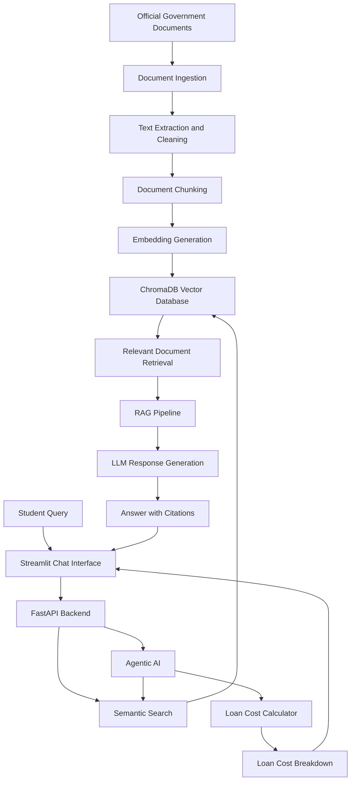

# 🎓 VidyaLoan – AI-Powered Education Loan Assistance System

**An intelligent, AI-powered platform that simplifies education loan discovery, eligibility understanding, interest subsidy calculation, and application assistance for Indian students.**

<p align="center">


</p>

---

## 👨‍💻 Project Information

| Field | Details |
|---|---|
| Student Name | Tushar Sachin Vargude |
| PRN | 2124UDSM2015 |
| Roll Number | 38 |
| Project Name | VidyaLoan |
| Project Domain | Artificial Intelligence & Data Science |
| Institution | Sanjivani University |
| Project Type | AI-Powered Education Loan Assistance Platform |

---

## 📌 1. Project Overview

VidyaLoan is an AI-powered education loan assistance platform designed to help Indian students understand government education loan schemes, eligibility requirements, financial assistance, interest subsidies, repayment conditions, and loan-related queries.

Students often struggle to understand multiple education loan schemes because information is distributed across government guidelines, banking policies, official portals, and lengthy PDF documents.

VidyaLoan addresses this problem using Natural Language Processing (NLP), Large Language Models (LLMs), Retrieval-Augmented Generation (RAG), semantic search, and Agentic AI.

The system retrieves relevant information from official government documents and provides contextual answers with source citations.

It also includes an education loan cost calculator that helps students understand principal amounts, interest during the moratorium period, government subsidies, and estimated monthly EMI.

**The ultimate goal is to make education loan information more accessible, understandable, and transparent for students.**

---

## 🎯 2. Problem Statement

Many students in India face difficulties accessing and understanding education loan information.

Major challenges include:

- Lack of awareness about government education loan schemes.
- Difficulty understanding eligibility requirements and income limits.
- Confusion between PM-Vidyalaxmi, CSIS, CGFSEL, and other education loan policies.
- Difficulty calculating interest subsidies and repayment amounts.
- Government guidelines and loan-related information are distributed across multiple documents and websites.
- Students struggle to identify which benefits apply to their individual circumstances.

### Proposed Solution

VidyaLoan provides a centralized AI-powered platform that:

1. Collects and organizes official education loan information.
2. Processes government guidelines and scheme documents.
3. Uses semantic search to retrieve relevant information.
4. Uses RAG to generate context-aware answers with citations.
5. Uses an AI agent to access loan calculation tools.
6. Calculates estimated interest subsidies and monthly EMI.
7. Provides an interactive chatbot for student assistance.

---

## 👥 3. Target Users

- College and university students.
- Students planning higher education.
- Students from economically weaker backgrounds.
- Parents and guardians seeking education loan information.
- Students exploring government education loan schemes.
- Students requiring assistance with eligibility and repayment calculations.

---

## 🏛️ 4. Government Schemes Covered

VidyaLoan focuses on the following education loan schemes and policies:

### PM-Vidyalaxmi Scheme

- Collateral-free and guarantor-free education loans for eligible students.
- 3% interest subvention for eligible students with annual family income up to ₹8 lakh, subject to scheme conditions.
- Credit guarantee support.
- Integration with existing CSIS benefits.
- Repayment provisions and moratorium information.

### Central Sector Interest Subsidy Scheme (CSIS)

- Interest subsidy for eligible students from families with annual income up to ₹4.5 lakh.
- Full interest subsidy during the eligible moratorium period.
- Applicable to qualifying professional and technical courses and institutions.
- Moratorium period generally covers course duration plus one year.

### Credit Guarantee Fund Scheme for Education Loans (CGFSEL)

- Credit guarantee support for eligible education loans.
- Loan coverage up to ₹7.5 lakh under the applicable scheme.
- 75% guarantee coverage under the relevant guarantee provisions.
- Applicable guarantee fee and lender responsibilities.

**Note:** Scheme eligibility, subsidy amounts, guarantee provisions, and financial limits are subject to the applicable official guidelines and amendments. PM-Vidyalaxmi, CSIS, and CGFSEL have separate eligibility and benefit conditions.

---

## 📚 5. Data Sources

The project uses official government documents and education loan information.

| Source | Purpose |
|---|---|
| [PM-Vidyalaxmi Guidelines](https://www.education.gov.in/sites/upload_files/mhrd/files/document-reports/PM_Vidyalaxmi_Scheme_Guidelines.pdf) | Scheme features, eligibility, subsidy and repayment |
| [PM-Vidyalaxmi Portal FAQs](https://pmvidyalaxmi.co.in/PublicFaq.aspx) | Frequently asked questions and answers |
| [Ministry of Education](https://www.education.gov.in/) | Official education policies and guidelines |
| [National Credit Guarantee Trustee Company](https://www.ncgtc.in/) | Credit guarantee information |
| [CSIS Scheme Information](https://www.education.gov.in/scholarships-education-loan-4) | Interest subsidy guidelines |

### Dataset Structure

Each education loan record contains:

- `scheme_name`
- `who_is_eligible`
- `income_limit`
- `loan_limit`
- `benefit`
- `source_url`

The dataset is designed to support document retrieval, searching, eligibility analysis, and AI-powered question answering.

---

## 🛠️ 6. Technology Stack

| Category | Technologies |
|---|---|
| Programming Language | Python |
| Backend Framework | FastAPI |
| Frontend | Streamlit |
| Data Processing | Pandas, NumPy |
| Data Validation | Python Dataclasses |
| AI / LLM | Groq / Gemini |
| NLP | TF-IDF, Sentence Transformers |
| Embeddings | Sentence Transformers |
| RAG Framework | Custom RAG Pipeline |
| Vector Database | ChromaDB |
| Similarity Search | Cosine Similarity |
| Agentic AI | Custom Agent Loop, LangGraph |
| Visualization | Matplotlib / Streamlit Charts |
| Testing | Pytest |
| Code Quality | Ruff |
| Containerization | Docker, Docker Compose |
| Version Control | Git and GitHub |
| Deployment | Render / Hugging Face Spaces |

---

## 🏗️ 7. System Architecture

The proposed architecture follows a modular AI application design.



### System Workflow

1. Collect official government documents and scheme FAQs.
2. Extract and clean document content.
3. Convert documents into manageable text chunks.
4. Generate embeddings for semantic representation.
5. Store document embeddings in ChromaDB.
6. Receive student questions through the chatbot.
7. Retrieve relevant documents using semantic similarity.
8. Generate contextual responses using an LLM.
9. Provide supporting citations from retrieved documents.
10. Use the education loan calculator for financial computations.

---

## 🚀 8. Development Roadmap

The project is developed through a structured multi-stage implementation plan.

### Day 01 – Project Foundation

- Create the VidyaLoan project card.
- Define the product, target user, problem, and data source.
- Implement Python variables and f-strings.
- Accept user input using `input()`.
- Build a menu-driven application using while loops and conditional statements.
- Initialize Git and GitHub.

### Day 02 – Dataset Collection and Modularization

- Collect 20 education loan scheme records.
- Extract PM-Vidyalaxmi scheme features.
- Collect 10 PM-Vidyalaxmi portal FAQ records.
- Add CGFSEL and CSIS rules.
- Store records as Python dictionaries.
- Implement keyword search and category counting.
- Create modular functions in `app/records.py`.
- Build a command-line interface.
- Configure virtual environment, requirements, and Git ignore files.

### Day 03 – Data Ingestion and Document Processing

- Download official scheme guidelines and FAQs.
- Store original documents inside `data/raw/`.
- Build `app/ingest.py` for document processing.
- Clean and normalize extracted information.
- Handle invalid records using exception handling.
- Save structured records into `data/records.json`.
- Implement a Record dataclass.
- Build document fetching functionality using Requests.

### Day 04 – FastAPI and Data Analysis

- Develop FastAPI backend services.
- Implement `/health`.
- Implement `/records`.
- Implement `/records/{id}`.
- Implement `/search`.
- Implement `/questions`.
- Analyze records using Pandas.
- Develop TF-IDF and cosine similarity-based smart search.
- Tag the first development milestone.

### Day 05 – Understanding LLMs

- Create `docs/how_llms_work.md`.
- Understand Large Language Models.
- Document how LLMs process natural language.
- Create a conceptual architecture diagram.
- Prepare 10 real VidyaLoan user questions.
- Establish the first project checkpoint.

### Day 06 – LLM Integration and Prompt Engineering

- Implement an LLM provider wrapper using Groq or Gemini.
- Integrate the LLM with FastAPI.
- Develop the `/chat` endpoint.
- Create system prompts and task prompts.
- Return structured JSON responses.
- Compare different prompt versions using evaluation questions.
- Keep API credentials inside `.env`.

### Day 07 – Document Chunking and Embeddings

- Implement document chunking.
- Preserve source, page number, and document title.
- Generate semantic embeddings.
- Evaluate retrieval performance.
- Implement a persistent ChromaDB vector collection.
- Develop semantic search functionality.

### Day 08 – Retrieval-Augmented Generation (RAG)

- Build the RAG pipeline.
- Retrieve relevant government document chunks.
- Generate answers using retrieved context.
- Include source citations.
- Return an appropriate "I don't know" response when information is unavailable.
- Build a 15-question evaluation dataset.
- Compare retrieval configurations.

### Day 09 – Agentic AI and Loan Calculator

- Build an education loan cost calculator.
- Calculate principal, moratorium interest, eligible government subsidy, and EMI.
- Apply CSIS and PM-Vidyalaxmi eligibility conditions.
- Develop a custom Agent Loop.
- Enable the agent to use RAG search and the loan calculator.
- Rebuild the agent using LangGraph.
- Add memory and an approval step.

### Day 10 – Streamlit Frontend

- Build an interactive VidyaLoan chatbot.
- Connect Streamlit with FastAPI.
- Display source citations.
- Add thumbs-up and thumbs-down feedback.
- Implement the signature loan cost breakdown chart.
- Visualize principal, moratorium interest, government subsidy, and family-paid interest.
- Prepare the second project checkpoint and live demonstration.

### Day 11 – Testing and Containerization

- Create automated tests using Pytest.
- Test records, search, API endpoints, RAG, and agent tools.
- Apply Ruff code-quality checks.
- Create Dockerfile and Docker Compose configuration.
- Add Docker instructions to README.

### Day 12 – CI/CD and Deployment

- Configure GitHub Actions.
- Run Ruff, Pytest, and Docker build checks.
- Create and merge a feature branch through a pull request.
- Deploy the application using Render or Hugging Face Spaces.
- Verify the publicly accessible health endpoint.

### Day 13 – Performance and Production Improvements

- Measure API latency and token consumption.
- Implement caching.
- Add request input limits.
- Test prompt-injection protection.
- Document production performance metrics.
- Prepare a system architecture diagram.
- Create resume project descriptions.

### Day 14 – Documentation and Interview Preparation

- Prepare a 60-second project pitch.
- Document 10 likely interview questions.
- Explain technical architecture and design decisions.
- Discuss challenges involving overlapping education loan schemes.
- Validate that financial calculations come from the deterministic calculator rather than LLM-generated figures.
- Close open tasks in `PROGRESS.md`.

### Final Day – Demonstration and Evaluation

- Perform a 45-minute final project test.
- Deliver a 5-minute live VidyaLoan demonstration.
- Participate in a 3-minute technical Q&A.
- Demonstrate the chatbot, citations, and loan cost calculator.
- Present the deployment URL, documentation, and project results.

---

## 💡 9. Signature Feature – Education Loan Cost Breakdown

The signature feature of VidyaLoan is its education loan cost calculator.

It helps students understand how much of their education loan cost may be covered by government interest subsidies.

### Proposed Calculation Components

| Component | Description |
|---|---|
| Principal | Original education loan amount |
| Moratorium Interest | Interest accumulated during the moratorium |
| CSIS Subsidy | Eligible interest subsidy during the moratorium |
| PM-Vidyalaxmi Subsidy | Eligible 3 percentage-point interest subvention |
| Family-Paid Interest | Remaining interest payable by the borrower |
| Monthly EMI | Estimated monthly repayment amount |

The calculator will consider:

- Loan amount.
- Interest rate.
- Course duration.
- Family annual income.
- QHEI eligibility.
- Moratorium period.
- Repayment duration.

**Financial accuracy principle:** The LLM will explain financial information, but actual rupee calculations and eligibility checks will be performed by deterministic Python logic using verified scheme rules.

---

## 📊 10. Evaluation Strategy

VidyaLoan will be evaluated using multiple criteria:

- Dataset accuracy and completeness.
- Retrieval relevance.
- Answer correctness.
- Citation accuracy.
- Eligibility-rule correctness.
- Financial calculation accuracy.
- API response time.
- Token consumption.
- User feedback.

Evaluation datasets will include real-world student questions, including questions that cannot be answered from available documents.

The system should acknowledge missing information rather than generate unsupported answers.

---

## 🔒 11. Security and Reliability

The project will incorporate:

- Environment-based API key management.
- `.env` exclusion from Git.
- Input validation.
- API error handling.
- Prompt-injection testing.
- Request size limits.
- Caching and latency monitoring.
- Source-based answer verification.
- Automated tests and CI/CD checks.

---

## 📁 12. Planned Project Structure

```text
GenAi/
│
├── README.md
├── PROGRESS.md
├── requirements.txt
├── .gitignore
├── .env.example
├── Dockerfile
├── docker-compose.yml
│
├── data/
│   ├── raw/
│   ├── records.json
│   └── sample_records.py
│
├── app/
│   ├── __init__.py
│   ├── main.py
│   ├── models.py
│   ├── records.py
│   ├── ingest.py
│   ├── fetch.py
│   ├── smart_search.py
│   ├── llm.py
│   ├── chunking.py
│   ├── embed.py
│   ├── vectorstore.py
│   ├── rag.py
│   ├── tools.py
│   ├── agent_loop.py
│   ├── graph.py
│   └── cli.py
│
├── analysis/
│   └── explore.py
│
├── prompts/
│   ├── system.txt
│   └── tasks/
│
├── eval/
│   ├── eval_set.json
│   ├── prompt_compare.md
│   └── search_results.md
│
├── docs/
│   ├── how_llms_work.md
│   ├── interview.md
│   └── resume.md
│
├── ui/
│   └── app.py
│
├── tests/
│
└── .github/
    └── workflows/
        └── ci.yml
```

*Note: This is the planned architecture. Files will be introduced progressively as development advances.*

---

## 🎓 13. Learning Outcomes

Through VidyaLoan development, the project aims to demonstrate practical knowledge of:

- Python programming and modular architecture.
- Data collection and preprocessing.
- REST API development.
- Natural Language Processing.
- Large Language Models.
- Retrieval-Augmented Generation.
- Vector databases and embeddings.
- Semantic search.
- Agentic AI and LangGraph.
- Financial rule-based computation.
- Docker and CI/CD.
- Automated testing and deployment.

---

## 👨‍💻 14. Developer

**Tushar Sachin Vargude**

- PRN: 2124UDSM2015
- Roll Number: 38
- Institution: Sanjivani University
- Domain: Artificial Intelligence and Data Science

**Project:** VidyaLoan – AI-Powered Education Loan Assistance System

---

## 📌 15. Project Status

**Current Stage:** Day 01 / Day 02 – Foundation and dataset development.

This project is under active development. Planned capabilities will be implemented, tested, and documented progressively.

---

## 📜 16. Disclaimer

VidyaLoan is an educational and informational project. It is not an official government portal, bank, financial institution, or loan approval authority.

All scheme details, income thresholds, interest subsidy rules, and financial calculations must be validated against the latest applicable official government and banking guidelines.

Loan approval is subject to the respective lending institution's policies and eligibility requirements.

---

**Built with Python, AI, and a vision to make education loan information more accessible to every student.**