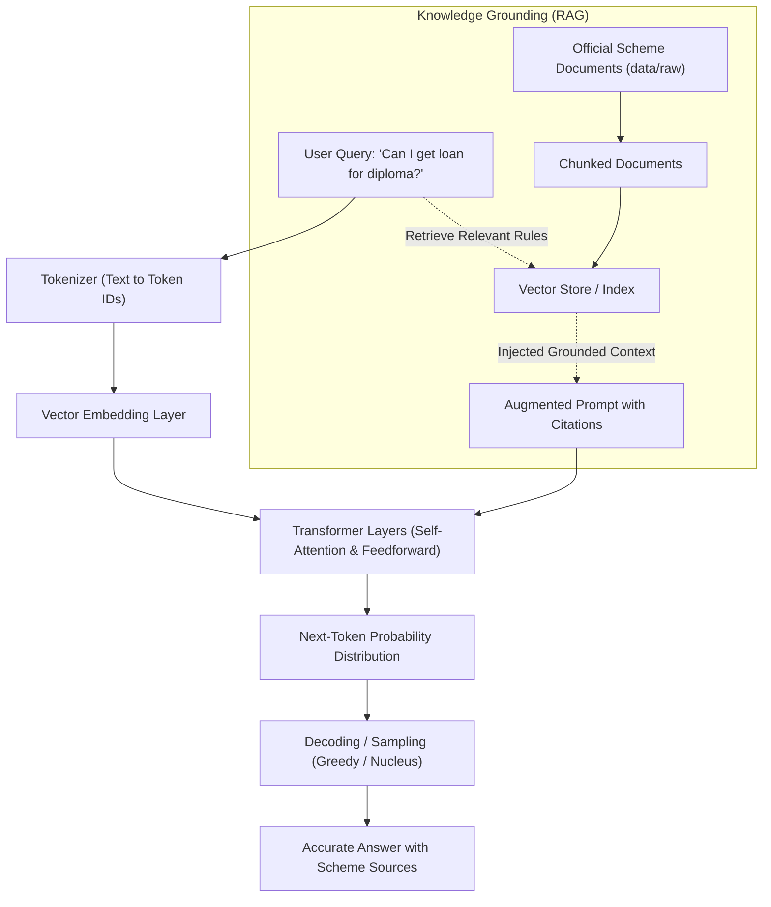

# How Large Language Models (LLMs) Work

## 1. Fundamentals of Large Language Models

A **Large Language Model (LLM)** is a statistical machine learning system trained on vast corpora of text to predict the most probable next word (or token) given a preceding sequence of words.

### Core Concepts

1. **Tokenization:**
   Text is split into smaller units called tokens (words, sub-words, or character fragments). For example, the query *"Can I get loan for diploma?"* is converted into a sequence of integer token IDs.

2. **Vector Embeddings:**
   Each token ID is mapped into a high-dimensional vector space (e.g., 768 or 1536 dimensions) where semantic meaning is captured. Words used in similar contexts (such as *"loan"* and *"credit"*) end up close to each other in this vector space.

3. **Transformer Architecture & Self-Attention:**
   Modern LLMs rely on the Transformer architecture. The self-attention mechanism computes attention weights between every pair of tokens in a prompt. This enables the model to understand context and relationships regardless of the distance between words (for instance, linking *"3% interest subvention"* directly to *"income under 8 lakh"*).

4. **Autoregressive Next-Token Prediction:**
   The model processes the input context and generates output token-by-token. At each step, it outputs a probability distribution across the entire vocabulary and samples the next token based on temperature and decoding parameters.

5. **Why LLMs Hallucinate & Why RAG is Needed:**
   LLMs generate text based on statistical probabilities rather than guaranteed factual retrieval. When asked about specific, frequently updated government schemes (like PM-Vidyalaxmi or CSIS interest rules), an ungrounded LLM may hallucinate interest rates or eligibility limits. **Retrieval-Augmented Generation (RAG)** solves this by retrieving exact factual text chunks from official government guidelines and passing them into the model's prompt as context.

---

## 2. LLM & RAG Architecture Workflow



---

## 3. Ten Real VidyaLoan User Questions

Here are 10 real user queries representative of students and parents exploring government education loan schemes in India:

1. **Q1:** `Can I get loan to get admission in Sanjivani University?`
2. **Q2:** `Can I get loan for diploma?`
3. **Q3:** `What is the income limit for 3% interest subvention under PM-Vidyalaxmi?`
4. **Q4:** `What is the maximum loan limit covered by the 75% credit guarantee under PM-Vidyalaxmi?`
5. **Q5:** `What documents need to be uploaded on the PM-Vidyalaxmi portal?`
6. **Q6 (Out-of-Scope / Cannot Answer from Data):** `Can I get a loan to study medicine at Oxford University in the UK under PM-Vidyalaxmi?`  
   *(PM-Vidyalaxmi guidelines strictly govern domestic admissions to Quality Higher Education Institutions (QHEIs) within India; the system must state that this cannot be answered or is not eligible under domestic scheme rules).*
7. **Q7:** `How is the moratorium period defined for education loan repayment?`
8. **Q8:** `Is collateral or a third-party guarantee required for loans up to Rs. 7.5 lakh?`
9. **Q9:** `Is it mandatory to have an existing bank account to apply on the portal?`
10. **Q10:** `Which loan I should apply for less than 5 lakh income?`

---

## 4. Checkpoint 1: FastAPI Walkthrough

### How to Run FastAPI Service
```bash
uvicorn app.main:app --reload --port 8000
```
Open interactive Swagger documentation at: **[http://127.0.0.1:8000/docs](http://127.0.0.1:8000/docs)**.

### Detailed Code Walkthrough: `/search` Endpoint
The `/search` endpoint in `app/main.py` is powered by the `SmartSearch` engine:

```python
@app.get("/search")
def search(q: str, top_k: int = 5):
    engine = get_search_engine()
    results = engine.search(q, top_k=top_k)
    return {"query": q, "results": results}
```

#### How it works:
1. **Query Processing:** The endpoint accepts a query string `q` (e.g., *"interest subvention"*) and an optional `top_k` integer.
2. **TF-IDF Vectorization:** The query is transformed into a TF-IDF vector using the pre-fitted vectorizer trained on all ingested scheme records (`scheme_name`, `who_is_eligible`, `income_limit`, `loan_limit`, `benefit`).
3. **Cosine Similarity Computation:** The angle between the query vector and every record vector is computed to determine relevance.
4. **Ranking & Filtering:** Records are sorted in descending order of similarity score. Only records with positive relevance scores are returned up to `top_k`.
